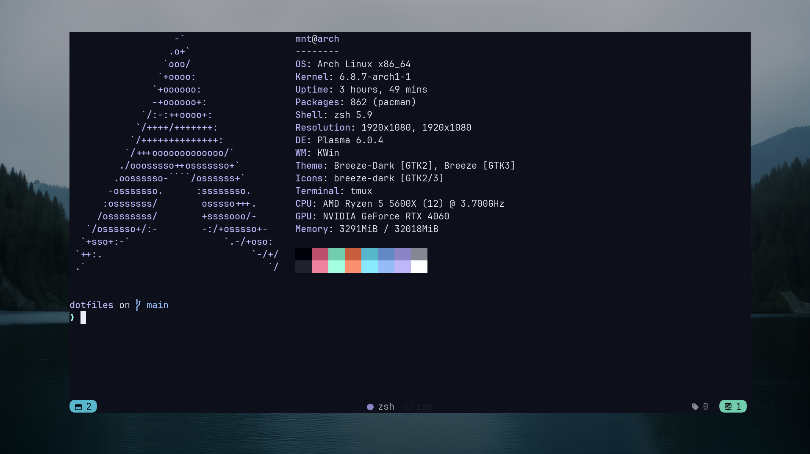

# Dotfiles



## Overview

- [Gooey (Gogh)](https://wezfurlong.org/wezterm/colorschemes/g/index.html#gooey-gogh)
- [WezTerm](https://wezfurlong.org/wezterm/)
- [zsh](https://ohmyz.sh/)
- [neovim](https://www.youtube.com/watch?v=dQw4w9WgXcQ)
- [tmux](https://www.youtube.com/watch?v=dQw4w9WgXcQ)


### Installing
You will need to install `git`

Clone the repo into `$HOME` directory

```bash
git clone https://github.com/0xMNT/dotfiles.git ~/dotfiles
```

Run install script for `arch, btw` distro. It installs packages from
`packages/pkglist.txt` (official repos) and `packages/pkglist-aur.txt` (AUR,
via `yay`), stows all dotfiles into `$HOME`, and sets up host-specific config.
Safe to re-run.

```bash
./install.sh
```

To refresh the package lists from the current machine after installing
something new:

```bash
pacman -Qqen > packages/pkglist.txt   # official repo packages
pacman -Qqem > packages/pkglist-aur.txt  # AUR / foreign packages
```

### GNU stow
`install.sh` already stows everything. To (re-)link a single config by hand:

```bash
stow -R -t "$HOME" alacritty
```
